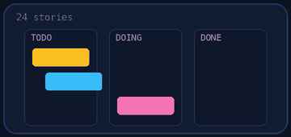
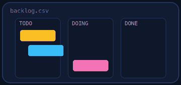
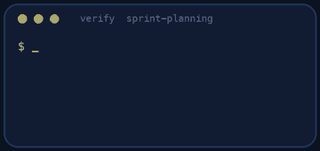

<p align="center"></p>

| | |
|-|-|
| **Time** | 60-75 min |
| **Cost** | free |
| **You need** | A text editor and Python 3 |

## How this lab works

1. **Fork** this repository to your own GitHub account (button at the top right).
2. Clone **your fork** in your Ubuntu environment (WSL on Windows, your OrbStack machine on Mac).
3. Read the lab below (the same text is in [`LAB.md`](LAB.md)) and follow the mission.
4. Answer the questions in [`SUBMISSION.md`](SUBMISSION.md). Where a question asks for output, paste it in a code block. No screenshots needed.
5. Commit and push. Open the **Actions** tab of your fork (click *I understand my workflows, go ahead and enable them* the first time). The **Lab check** shows what is still missing.
6. When the check is green, **submit the URL of your fork** in the course platform.

> [!NOTE]
> The check only looks at your answers and any files the lab asks you to commit. Your instructor reads your work and may ask you to explain any line.

<p align="center"></p>

## 🎬 The situation

<p align="center"></p>

Monday, 09:30, sprint planning. The product owner arrives with 24 stories and one sentence: *"We need everything by the launch."* The reality in the room:

- Maya is out for three days, and Sam has four days of other commitments
- There is a **P1 bug in production** since Friday
- Some stories **cannot start** before others finish
- Two stories are estimated at **13 points**, too big to finish and too big to trust
- The team has finished 31, 28 and 34 points in the last three sprints, and a stakeholder wants 60

Your role is Scrum Master and developer in one. You will plan a sprint the team can **honestly** deliver, and explain what is not in it.

> [!IMPORTANT]
> **Your mission**
> - Work out the sprint **capacity** from velocity and availability
> - Choose and order stories: the must-have first, dependencies respected, value maximised
> - Slice work that is too big, write a sprint **goal** and a **Definition of Done**
> - Say out loud what you are **not** doing and why

**Time:** 60-75 min | **Cost:** free | **You need:** a text editor and Python 3 (to run the checker)

<p align="center"></p>

## Part 0 - Set the scene

Fork this repository and clone your fork. Three files hold the facts:

- `backlog.csv`: the 24 stories with type, business value (1-10), story points, dependencies, risk, and `must` (yes means it has to be in this sprint)
- `team.csv`: who is available how many days out of the ten days of the sprint
- `velocity.csv`: what the team committed to and **completed** in the last three sprints

Open them in a spreadsheet or a text editor.

<p align="center"></p>

## Part 1 - Recon: read the room

<p align="center"></p>

1. Which stories are bugs? Which story is the `must`? Why is it the first thing you plan?
2. Draw the dependency chains. Which story blocks which? (Look at `depends_on`.) Which chain is the longest?
3. Which stories are `high` risk? What does risk change about when you want to do them?
4. Which stories have a 13-point estimate? What does a 13 tell you about how well the team understands it?
5. The backlog's total is more than 100 points. What does that mean for the stakeholder's "everything"?

> [!NOTE]
> **Predict** If the team commits to the number the stakeholder asked for (60 points), how many points do you think it will complete? Base your guess on `velocity.csv`: compare *committed* with *completed*.

<p align="center"></p>

## Part 2 - Capacity: how much can we honestly take?

Calculate in your notes:

1. **Average velocity** = the mean of the *completed* column (not the committed one).
2. **Availability** = total days available divided by total days in the sprint.
3. **Capacity** = average velocity x availability, rounded **down**.

Write the three numbers and the result at the top of your plan. You should commit to between **80% and 100%** of capacity: less is wasteful, more is a promise you will break.

> [!NOTE]
> **Think** Why use the *completed* points of past sprints and not the committed ones? What does an estimate of 8 points mean: hours, days, or something else? Why do many teams avoid converting points into hours?

<p align="center"></p>

## Part 3 - Build the sprint

Create `sprint-plan.md` with exactly these sections (the headings matter, the checker looks for them):

```text
# Sprint 15 plan

## Sprint goal
One or two sentences, 10 to 40 words, describing the outcome for users, not a list of ticket numbers.

## Sprint backlog
- S01 (2 pts): why it is first
- S16 (5 pts): why this one next
...

## Left out
- S12: a reason of at least five words
...

## Definition of Done
- at least three bullets

## Risks
- at least two bullets
```

Rules:

- Backlog lines look like `- S01 (2 pts): note`. List them **in the order you would work on them**. A story's dependency must appear **before** it and must be in the sprint.
- Include the `must` story.
- Total points: between 80% and 100% of your capacity.
- Stories over 8 points cannot go in whole. If you want one, **slice** it: use ids like `S09a (5 pts)` and `S09b (5 pts)` where each slice can be released on its own and is no bigger than the parent. Slicing is a skill, think about *vertical* slices (a thin piece of the whole feature) and not horizontal ones ("do the database part first").
- At most one spike.
- Under **Left out**, list at least three stories with a reason you could say to the product owner.

> [!WARNING]
> **Break it** Run `python3 verify.py` early and often. Break your own plan on purpose: put a story before its dependency, go over capacity by one point, drop the must. Read how each failure is reported.

<p align="center"></p>

## Part 4 - Defend it

Imagine the product owner reads your plan. Prepare for two questions:

1. *"Why is billing not in the sprint? It is our revenue goal."* Answer using dependencies and risk.
2. *"Can't you just add the dark mode, it is only three points?"* Answer using capacity and value.

Write the answers in your submission, 2 sentences each.

<p align="center"></p>

## Part 5 - Prove it

<p align="center"></p>

```bash
python3 verify.py
```

The checker re-computes capacity, validates dependencies and order, compares the value you deliver with the best possible selection, and checks that your goal, Left out, Definition of Done and Risks sections are real. It also runs automatically in your fork when you push.

<p align="center"></p>

## Level up (optional)

- **Slice a monster.** Slice the Redis story (13) into three vertical slices with acceptance criteria. Which slice delivers value first?
- **Re-plan on Wednesday.** A new P1 bug arrives with 3 points. What leaves the sprint and why? Write the one-paragraph message to the team.
- **Forecast.** At your capacity, how many sprints until the whole backlog is done? What does that say about "we need everything by the launch"?

<!-- submission:start (generated by labs.py, do not edit) -->
## 📬 Submission

Answer the questions in `SUBMISSION.md` in **your fork** (paste output in code blocks where asked), push, then submit the **URL of your fork**.

**Files to commit**

- `sprint-plan.md`: your sprint plan, committed to the repo

**Questions to answer**

1. What was your capacity in story points and how did you calculate it? Why not simply commit to the biggest number the stakeholder asked for?
2. Which stories did you leave out, and how would you explain that to the stakeholder in two sentences each? Which one hurt most?
3. Which dependency chain forced the order of your stories, and what would have happened if you had pulled the last story in the chain without the first?
4. Pick a 13-point story. Show how you would slice it into stories of 8 points or less that each deliver value on their own. Did you include a slice in your sprint, and why or why not?
5. What is the difference between the sprint goal and the list of stories? Why is a goal more useful than a list when plans change on Wednesday?
6. Paste the output of `python3 verify.py`. It must end with **ALL CHECKS PASSED**. Also include the two short answers from Part 4.
<!-- submission:end -->
